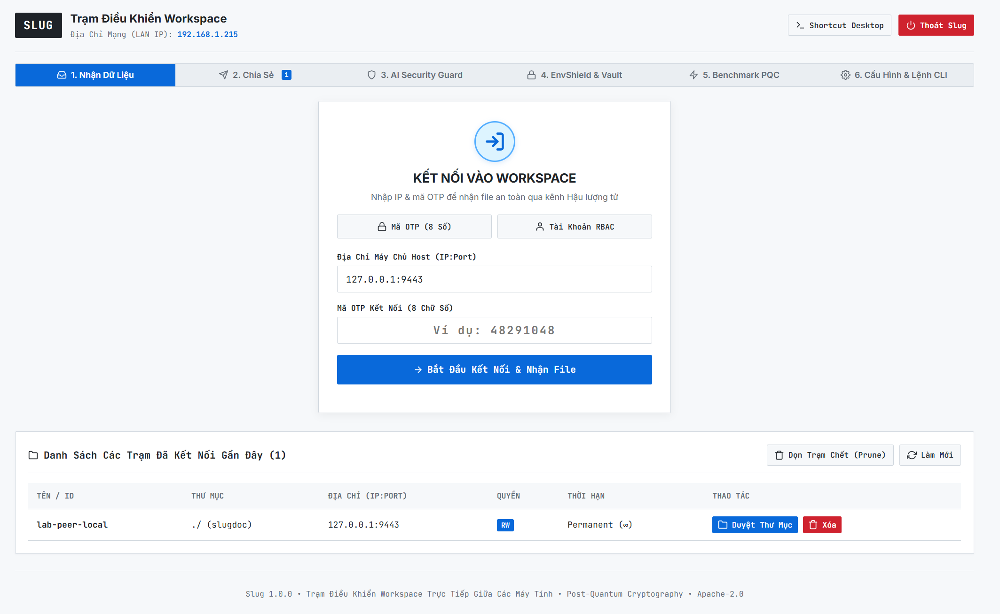
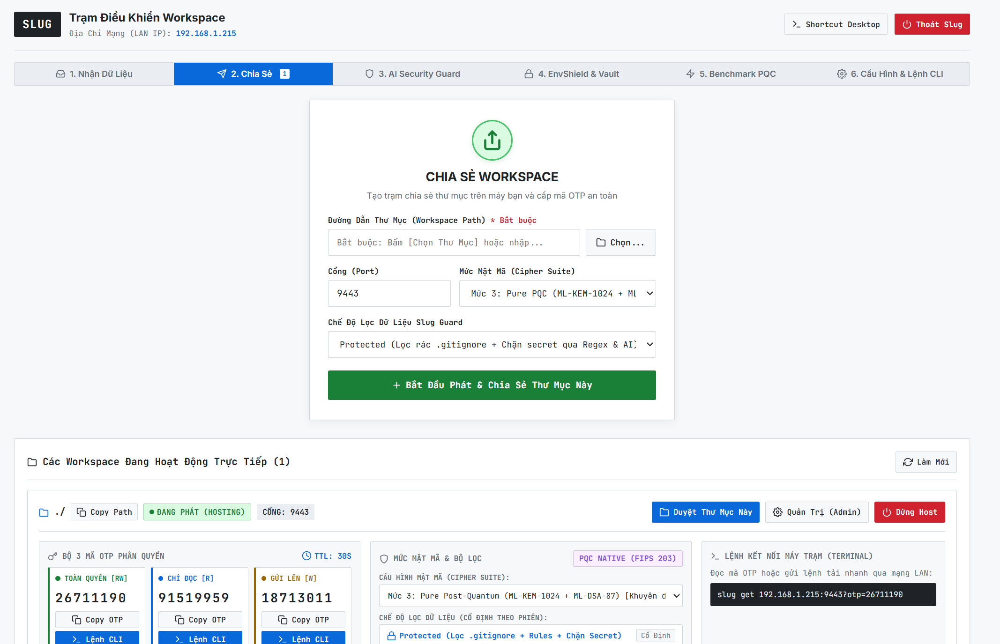
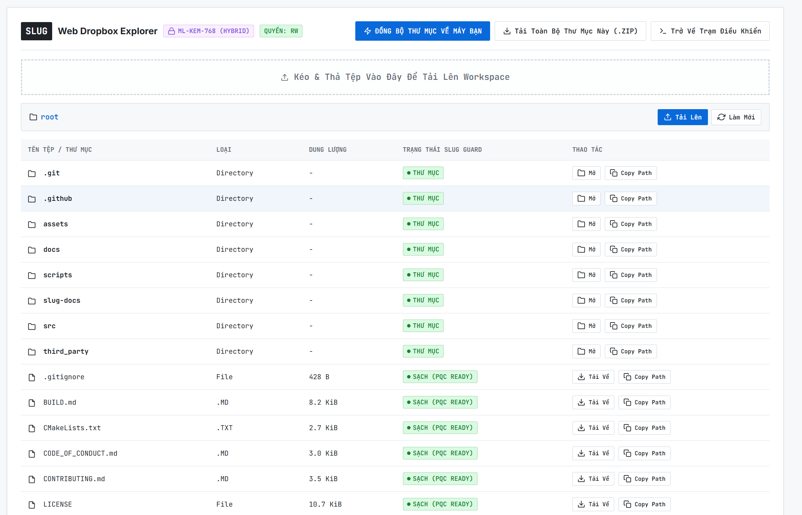

<p align="center">
  
</p>

# Slug: Secure, Ephemeral, Git-like Workspace Sharing & Synchronization

[](https://opensource.org/licenses/Apache-2.0)
[](https://en.wikipedia.org/wiki/C%2B%2B20)
[](https://csrc.nist.gov/Projects/post-quantum-cryptography)
[](BUILD.md)

> **Slug: Lớp lá chắn bảo vệ bí mật chủ động trước các trợ lý AI & Nền tảng chia sẻ Workspace an toàn giữa người với người không lo thừa hoặc nhầm file bí mật.**  
> *(Proactive Secret Shield Against AI Assistants & Safe Human-to-Human P2P Workspace Sharing)*

---

## 1. Tuyên Bố Giá Trị Cốt Lõi & Nhận Thức Thực Tế (No-Overclaim Philosophy)

### 1.1. Lá Chắn Bảo Vệ Bí Mật Chủ Động Trước Các Trợ Lý AI (EnvShield)
Trong kỷ nguyên lập trình hiện đại với các trợ lý AI (Cursor, Copilot, Claude Code, Antigravity, Devin, v.v.), AI liên tục lập chỉ mục và đọc các tệp trong workspace để nạp context vào mô hình ngôn ngữ lớn (LLM) gửi về cloud.
- **Rủi ro thực tế:** Nếu tệp cấu hình chứa secret (`.env`, private key, API token) nằm dưới dạng bản rõ (plaintext) trên ổ đĩa, AI sẽ tự động đọc lén và đưa toàn bộ bí mật vào context window hoặc log chat mà lập trình viên không hề hay biết.
- **Cách Slug giải quyết:**
  - `slug env init`: Mã hóa file `.env` thành `.env.pqc` bằng mật mã hậu lượng tử, lưu bản sao niêm phong vào Central Vault (`~/.slug/env_vault/`) và **xóa hoàn toàn bản rõ khỏi đĩa cứng trong repo**.
  - `slug env prompt`: Xuất hướng dẫn tự động tạo `.slug/ai-rule.md` để huấn luyện AI luôn thực thi lệnh qua công cụ wrapper.
  - `slug env run -- <command>`: Slug giải mã bí mật duy nhất trong bộ nhớ RAM tạm thời của tiến trình con lúc chạy. **AI không bao giờ được tiếp xúc trực tiếp với tệp plaintext trên đĩa cứng.**
- **Góc nhìn kỹ thuật thẳng thắn (Tránh Overclaim):**
  - *Có đọc được không nếu cố tình?* **Có!** Khi ứng dụng chạy, các biến môi trường hiển nhiên phải tồn tại trong bộ nhớ RAM của process để code hoạt động. Nếu người dùng cố tình viết lệnh `printenv` hoặc dump memory thì vẫn đọc được.
  - *Tại sao cách tiếp cận này lại hiệu quả?* Các trợ lý AI là tác nhân hỗ trợ (cooperative agents), chúng **không bao giờ chủ động tìm cách bypass hay khai thác bộ nhớ RAM** (trừ phi người dùng cố tình viết prompt yêu cầu AI làm điều đó).
  - *Giá trị thực chất:* Slug tạo ra một **rào cản ma sát chủ động (proactive friction barrier)** ngăn chặn triệt để hành vi đọc plaintext thụ động từ ổ đĩa, đảm bảo secret không bị nuốt chửng vào context window của LLM trong công việc hàng ngày.

### 1.2. Chia Sẻ An Toàn Giữa Người Với Người (Không Lo Thừa Rác, Không Lo Nhầm Bí Mật)
Khi cần chia sẻ nhanh workspace cho đồng nghiệp, mentor, tester hoặc đối tác:
- **Không lo chia sẻ thừa file rác:** Tự động nhận diện phân tầng `.gitignore` của dự án, loại bỏ sạch sẽ các thư mục build nặng nề (`node_modules/`, `target/`, `build/`, file tạm).
- **Hệ thống phòng vệ 4 Cấp Độ Lọc (4 Filter Levels):**
  - **Level 1 — Rules (`.gitignore` + `.slug/rules.conf`):** Lọc theo đường dẫn và chính sách cấu hình do Host chỉ định. Hỗ trợ Whitelist với tiền tố `!` (ví dụ: `!.env.example`, `!*.example`). Ngừng sử dụng `.slugignore` cũ.
  - **Level 2 — Regex (Level 1 + Secret Detection):** Tự động phát hiện AWS/GitHub/Stripe keys, private keys, JWT, URLs chứa mật khẩu trong mã nguồn.
  - **Level 3 — Entropy (Level 2 + Shannon Entropy):** Tính toán độ hỗn loạn $H(X) \ge 4.0$ trên các tệp mã nguồn/văn bản (`is_scannable_file`). Tự động miễn nhiễm hoàn toàn false positive cho tệp nhị phân, compiled, media (`.pyd`, `.dll`, `.png`, `.mp4`, `.zip`...).
  - **Level 4 — AI (Level 3 + AI Contextual Advisor):** Kết nối LLM (Ollama / OpenAI / Gemini với cờ `--ai-model`) tham vấn ngữ cảnh mã, trả về schema JSON (`has_secret`, `reason`, `line`).
- **Directory Visibility Invariant (Bất biến hiển thị cây thư mục):** Cấu trúc cây thư mục luôn được giữ nguyên trọn vẹn, không bao giờ tự ý tỉa cành hay ẩn file bị lọc. File chỉ có 2 trạng thái chuẩn hóa trên Explorer: `AVAILABLE` (màu xanh lá, được phép tải) hoặc `BLOCKED` (màu đỏ, bị chặn ở backend). Chỉ có metadata nội bộ (`.slug/`, `.git/`) là bị ẩn và bảo vệ bất biến.

### 1.3. Kiến Trúc Engine Viewing Nội Bộ (Zero Remote HTTP)
- Trên mạng dây LAN/Internet **chỉ tồn tại kết nối nhị phân PQC an toàn lượng tử** (mặc định cổng `9443`). Tuyệt đối không phơi bày cổng Web HTTP ra ngoài Internet!
- Giao diện Web chỉ là một **Engine Viewing nội bộ chạy trên loopback `127.0.0.1:8080`** của máy client và **Host Admin Dashboard tại `http://127.0.0.1:<port>/admin`**. Mọi thao tác duyệt cây thư mục, tải file đơn, tải file nén ZIP toàn thư mục hay upload đều được tunnel mã hóa qua các frame PQC nhị phân. Không có bất kỳ byte HTTP lộ thiên nào trên mạng!

---

## 2. Cài Đặt & Biên Dịch Nhanh (Installation & Build)

Slug được đóng gói dưới dạng binary tĩnh độc lập (100% Static Binary, ~8.4 MB) không phụ thuộc vào `glibc` của hệ thống máy chủ, chạy mượt mà trên mọi bản phân phối Linux và Windows.

### 2.1. Cài Đặt Nhanh (Quick Install)

#### Quick Install (Linux / macOS)
```bash
# Automated 1-liner installer:
curl -fsSL https://raw.githubusercontent.com/dotlinux26/slug/main/scripts/install.sh | bash

# Or Debian/Ubuntu .deb:
sudo dpkg -i dist/slug_1.0.0_amd64.deb

# Or standalone portable binary:
chmod +x slug-linux-x86_64 && sudo mv slug-linux-x86_64 /usr/local/bin/slug
```

#### Quick Install (Microsoft Windows)
```powershell
# Automated 1-liner installer (PowerShell):
irm https://raw.githubusercontent.com/dotlinux26/slug/main/scripts/install.ps1 | iex

# Or extract ZIP distribution archive:
Expand-Archive slug-1.0.0-windows-x86_64.zip -DestinationPath "$env:LOCALAPPDATA\slug\bin"
[Environment]::SetEnvironmentVariable("PATH", "$([Environment]::GetEnvironmentVariable('PATH','User'));$env:LOCALAPPDATA\slug\bin", "User")

# Or run standalone portable binary directly:
.\slug.exe version
```

### 2.2. Tạo Lối Tắt Màn Hình & Trải Nghiệm 1-Chạm (Windows Desktop Shortcut)
Slug hỗ trợ tạo ngay shortcut Desktop chuyên nghiệp để khởi chạy giao diện Web Viewing Engine chỉ bằng 1 cú nhấp chuột:
```powershell
slug shortcut
```
> **Đặc tính Absolute Stealth:** Khi mở từ Desktop Shortcut hoặc Windows Explorer, Slug tự động ẩn cửa sổ console terminal, mang lại trải nghiệm như một ứng dụng desktop native mượt mà.

### 2.3. Bật Tính Năng Tự Động Gợi Ý Lệnh (Shell Autocompletion)
Slug hỗ trợ tự động gợi ý cờ và các cổng workspace đang chạy cho Bash và Zsh:
```bash
# Đối với Bash:
slug completion bash > ~/.bash_completion.d/slug
source ~/.bash_completion.d/slug

# Đối với Zsh:
slug completion zsh > ~/.zsh/completion/_slug
```

### 2.4. Tự Biên Dịch Từ Mã Nguồn (Build From Source)
Yêu cầu: Trình biên dịch hỗ trợ C++20 (`g++-11+`, `clang++-14+`, hoặc MSVC 2022 v143), thư viện OpenSSL 3.0+ (hoặc OpenSSL 3.6.3 hỗ trợ NIST PQC).
```bash
# Trên Linux: Biên dịch binary động:
make -j$(nproc)

# Trên Linux: Biên dịch binary tĩnh 100% portable:
make static -j$(nproc)

# Trên Windows (MSVC 2022 Developer Command Prompt / PowerShell):
scripts\build_windows.bat

# Chạy toàn bộ 50 kịch bản kiểm thử tích hợp tự động:
bash scripts/test_local.sh
```

---

## 3. Trải Nghiệm Giao Diện Người Dùng & Web Viewing Engine

Slug tích hợp sẵn Web Command Center và Web Dropbox Explorer tinh gọn theo phong cách **Techno B2B** (bo góc sắc cạnh 2px, font JetBrains Mono, 100% SVG vector offline không phụ thuộc internet).

> **Chỉ cần gõ `slug` (không tham số) hoặc `slug portal`:** Hệ thống tự động kích hoạt Web Viewing Engine trên `http://127.0.0.1:8080/` và tự động mở trình duyệt mặc định của bạn!

### 3.1. Trạm Kết Nối & Quản Lý Phiên Làm Việc (Client Portal & Quick Connect)
> Cho phép nhập nhanh IP trạm và mã OTP 1 lần (hoặc tài khoản Ephemeral RBAC), tự động thương lượng kênh mật mã Hậu lượng tử NIST FIPS 203 và lưu danh sách trạm thường dùng để truy cập 1 chạm.

<p align="center">
  
</p>

### 3.2. Trạm Phát & Trung Tâm Điều Khiển Bảo Mật (Host Command Center & Slug Guard)
> Khởi tạo và quản lý đa trạm phát, giám sát bộ 3 mã OTP xoay vòng theo quyền hạn (`[rw]` Đọc/Ghi, `[r]` Chỉ Đọc, `[w]` Hộp Thư Nộp Bài), quản lý người dùng Ephemeral RBAC và tùy biến bộ quy tắc lọc (hỗ trợ Whitelist `!.env.example`).

<p align="center">
  
</p>

### 3.3. Trình Duyệt File Trực Quan & Web Dropbox Explorer (PQC Tunnel Browsing)
> Duyệt cây thư mục từ xa được bảo vệ bởi kênh mã hóa PQC, hỗ trợ tải từng tệp, nén tải toàn bộ thư mục ZIP và xem kế hoạch đồng bộ vi sai (Delta Fast-Path) trước khi kéo về máy.

<p align="center">
  
</p>

---

## 4. Quy Hoạch Lệnh Cốt Lõi ("The Essential Suite")

Toàn bộ hệ thống CLI của Slug tuân thủ nghiêm ngặt chuẩn POSIX/GNU:

```text
SLUG THE ESSENTIAL COMMAND SUITE

[CLIENT WORKSPACE & WEB VIEWING ENGINE]
  slug (không tham số)        Mở ngay Web Viewing Engine trên loopback http://127.0.0.1:8080/
  slug portal [-p <port>]     Chỉ định cổng loopback cho Web Viewing Engine (Aliases: slug web, slug ui)
  slug shortcut               Tạo lối tắt Desktop Windows ("Slug Workspace.lnk") chạy 1-chạm ẩn console
  slug config [list|get|set]  Quản lý cấu hình toàn cục (~/.slug/config.json): default_suite, portal_port

[HOST WORKSPACE]
  slug add <path>             Khởi tạo và host workspace (-p, -s, -t, --filter-level <1-4>, --ai-model <ollama|openai|gemini>, --otp-step, --workspace-ttl, --include-ignored, --no-filter, -d)
  slug host <path>            Bí danh tương đương với 'slug add'
  slug status                 Kiểm tra danh sách server đang chạy (-s rút gọn, -p <port>, --sessions, --flagged)
  slug totp [-p <port>]       Xem bảng 3 mã OTP phân quyền hoặc xuất mã nhanh (-r <role> --code-only)
  slug stop [-p <port>|-a]    Dừng server cụ thể hoặc toàn bộ server đang mở (-a, --all)
  slug serve [-p <port>] [-w] Bảng thông số server; truyền cờ -w để mở Web Host Admin Dashboard nội bộ (http://127.0.0.1:<port>/admin)

[ACCESS CONTROL & SECURITY]
  slug session <list|kill>    Giám sát và hủy phiên kết nối của các client đang truy cập (-p <port>)
  slug user <add|mod|rm|list> Quản lý tài khoản phân quyền RBAC: -u <user>, -P <pass>, -r <rw|r|w>, -t <ttl>
  slug audit <list|scan|allow>Quản lý các file nghi vấn bị Slug Guard chặn (list, scan, allow, recheck, clear; hỗ trợ --filter-level, --ai-model)
  slug rule <list|block|allow>Quản lý quy tắc lọc tệp .slug/rules.conf (hỗ trợ whitelist tiền tố '!')

[CLIENT WORKSPACE SYNC]
  slug connect -i <ip> -p <p> Xác thực với trạm chia sẻ từ xa và lưu chứng chỉ phiên vào danh bạ
  slug ls [subpath]           Duyệt danh sách file từ xa với trạng thái chi tiết (Available, Blocked, Quarantined)
  slug pull [scope] [--to <d>]Đồng bộ vi sai kiểu Git (Delta Sync 64 KiB), xem preview transfer plan (-y, --dry-run)
  slug get <file> [dest]      Tải ĐÚNG 1 file cụ thể được chỉ định từ xa (hỗ trợ cú pháp IP:PORT?otp=CODE)
  slug push <file> [dest]     Đẩy tệp lên trạm từ xa (yêu cầu quyền 'w' hoặc 'rw', dùng cho nộp bài hoặc sync)

[SYSTEM UTILITIES]
  slug conn <list|use|prune>  Quản lý danh sách kết nối đã lưu trên client (chuyển đổi trạm làm việc 1 lệnh)
  slug env                    Bảo vệ biến môi trường trong RAM & Central Vault (init, restore, history, prompt, run)
  slug bench [--quick|--json] Đo hiệu năng mật mã (ML-KEM-768, ML-DSA-65, BLAKE3, AEAD) và I/O đĩa
  slug completion <bash|zsh>  Sinh script gợi ý lệnh tự động cho shell
  slug version                Hiển thị thông tin phiên bản, bản quyền và chi tiết build
  slug uninstall [-y]         Gỡ cài đặt hoàn toàn Slug khỏi hệ thống (dọn binary, config, registry)
```

---

## 5. Hướng Dẫn Sử Dụng Nhanh (Quickstart)

### Kịch Bản 1: Khởi Tạo Workspace & Đồng Bộ Về Máy Khách (Full Sync)

**Bước 1: Trên máy chủ (Host):**
Khởi tạo chia sẻ thư mục hiện tại trên cổng 9443 với thuật toán Hậu Lượng Tử (Suite 3) và bật AI Guard:
```bash
slug add . -p 9443 -s pqc -t 1d --ai
```
Màn hình terminal sẽ xuất hiện bảng thông số và các mã OTP phân quyền:
```text
+----------------------------------------------------------------------------+
| SLUG SECURE WORKSPACE HOSTED SUCCESSFULLY                                  |
| Path:            D:/my-project                                             |
| Port:            9443                                                      |
| Crypto Suite:    Suite 3: PurePQC (BLAKE3/ML-DSA-65/ML-KEM-768/XChaCha)   |
| AI Secret Guard: ON (Stateful BLAKE3 Content-Addressable Index)            |
| Session TTL:     1d                                                        |
| Role OTPs (Rotates in 30s):                                                |
|   [rw] Read-Write OTP: 12822565 (Full Sync & Web Dropbox)                  |
|   [r]  Read-Only OTP:  08796195 (Read/Pull/View files only)                |
|   [w]  Write-Only OTP: 70788146 (Blind Drop/Upload only)                   |
+----------------------------------------------------------------------------+
```

**Bước 2: Trên máy khách (Client):**
Người nhận có 3 cách kết nối cực kỳ linh hoạt:

1. **Cách 1: Đồng bộ toàn bộ thư mục bằng lệnh `slug pull` (CLI):**
   ```bash
   slug pull -i 192.168.1.107 -p 9443 -o 12822565 --to ./my-project
   ```
   *Tiến trình sẽ tự động bắt tay ML-KEM-768, đốt hủy mã OTP một lần, tải manifest, tính toán vi sai 64 KiB và đồng bộ trọn vẹn dữ liệu.*

2. **Cách 2: Tải ĐÚNG 1 tệp tin cụ thể bằng lệnh `slug get` (Single-File Fetch):**
   ```bash
   slug get 192.168.1.107:9443?otp=12822565 src/main.cpp ./main.cpp
   ```

3. **Cách 3: Trải nghiệm đồ họa qua Web Viewing Engine (Zero Remote HTTP):**
   - Chỉ cần gõ:
     ```bash
     slug
     ```
   - Trình duyệt tự động mở `http://127.0.0.1:8080/`. Nhập IP `192.168.1.107:9443` và mã OTP `12822565` -> Nhấn **Kết Nối Nhanh**.
   - Tại Tab 3 (Web Dropbox), bạn có thể xem cây thư mục từ xa, tải từng file, hoặc nhấn **Tải ZIP Toàn Bộ Thư Mục** để nhận trọn vẹn dự án.

---

### Kịch Bản 2: Thu Bài Tập Phòng Máy Sinh Viên (Write-Only Blind Drop)

Khi giảng viên hoặc trưởng nhóm cần thu bài nộp của học sinh, sinh viên trong phòng lab nhanh gọn, không lo nghẽn mạng WAN:

1. **Trên máy giáo viên (Host):**
   Khởi tạo thư mục nhận bài:
   ```bash
   slug add ./bai_nop -p 9443
   ```
   Tạo nhanh tài khoản chung quyền Ghi `[w]` cho cả lớp trên Web Host Command Center hoặc qua CLI:
   ```bash
   slug user add -u sinhvien -P 123456 -r w -p 9443
   ```
   *(Lưu ý: Mã OTP 8 chữ số là vé bảo mật dùng 1 lần cho từng thiết bị cá nhân; việc tạo tài khoản RBAC chung với quyền `[w]` giúp 40–50 sinh viên cùng nộp bài đồng thời mà không bị xung đột).*

2. **Phía học sinh, sinh viên nộp bài:**
   - **Qua Web GUI:** Mở `slug`, nhập IP máy thầy `192.168.1.107:9443`, chọn tài khoản `sinhvien` / mật khẩu `123456` và kéo thả bài làm vào Web Dropbox.
   - **Qua CLI:**
     ```bash
     slug push ./bai_lam.zip -i 192.168.1.107 -p 9443 -u sinhvien -P 123456
     ```
   - **Bảo mật & Chống chép bài:** Tầng `SlugVFS Jail` cưỡng chế quyền `WRITE_ONLY`, học sinh chỉ được phép tải bài lên, **hoàn toàn bị cấm xem danh sách hoặc tải bài của các bạn khác về**. Hoạt động mượt mà ngay cả khi phòng máy mất kết nối Internet quốc tế!

---

### Kịch Bản 3: Thiết Lập Bộ Quy Tắc Lọc & Ngoại Lệ Whitelist (`!.env.example`)

Slug Guard hỗ trợ cơ chế đánh giá tuần tự (Sequential Rule Evaluation) tương thích với cú pháp `.gitignore`:
- Nếu bạn cấm toàn bộ file `.env*` nhưng muốn đồng đội vẫn nhận được file mẫu cấu hình `.env.example`:
  ```text
  # Trong file .slug/rules.conf hoặc trên Web Command Center:
  .env*
  !.env.example
  !*.example
  ```
- Quy tắc có dấu chấm than `!` ở đầu biểu thị luật **Whitelist (Cho phép ngoại lệ)**. Slug Guard sẽ tự động phê duyệt các file này ở trạng thái `Whitelisted / Clean` và không bao giờ cách ly nhầm.

---

### Kịch Bản 4: Bảo Vệ File `.env` Khỏi AI Coding Agents Với PQC EnvShield

Để ngăn ngừa các công cụ AI (như Cursor, Copilot, Claude Code) đọc lén file cấu hình chứa API key trên đĩa cứng:

```bash
# 1. Mã hóa .env thành .env.pqc, lưu bản sao ra Central Vault (~/.slug/env_vault/) và dọn sạch plaintext trong repo
slug env init

# 2. Xuất chỉ thị chuẩn để dạy AI luôn chạy lệnh qua công cụ (tự động tạo .slug/ai-rule.md)
slug env prompt

# 3. Chạy ứng dụng hoặc test: Slug giải mã duy nhất trong RAM và nạp biến môi trường cho tiến trình
slug env run -- python3 app.py
# hoặc
slug env run -- npm test

# 4. Khi cần sửa file hoặc thoát chế độ AI: Khôi phục 1 chạm về nguyên trạng .env
slug env restore

# 5. Xem lịch sử các bản backup đã niêm phong trong Central Vault
slug env history
```

---

## 6. Hệ Thống Tài Liệu Kỹ Thuật (Architecture & Technical Specs)

Hệ thống tài liệu chuyên sâu được phân định chi tiết theo từng khía cạnh kỹ thuật:

| Tài liệu | Nội dung trọng tâm |
| :--- | :--- |
| **[docs/README.md](docs/README.md)** | **Tổng quan hệ thống tài liệu & Cẩm nang thẩm định:** Tóm lược bản chất vấn đề, 4 kịch bản đời thường và ma trận thông tin đối chiếu hỗ trợ Hội đồng Ban giám khảo. |
| **[01-PROBLEM.md](docs/01-PROBLEM.md)** | Phân tích thực trạng: Lỗ hổng của `python -m http.server`, rủi ro tài khoản mồ côi SSH, ô nhiễm Git và nguy cơ rò rỉ secret vào AI coding assistants. |
| **[02-SOLUTION.md](docs/02-SOLUTION.md)** | Giải pháp toàn diện của Slug: Quy hoạch bộ lệnh cốt lõi, cơ chế đồng bộ vi sai `slug pull`, 3 bộ Suite mật mã, hệ thống tập tin ảo `SlugVFS` và Web Dropbox. |
| **[03-AI-USAGE.md](docs/03-AI-USAGE.md)** | Phòng thủ dữ liệu AI: Phân định minh bạch giữa **Slug Guard** (deterministic offline regex + entropy) và **Slug AI** (advisory JSON schema); công nghệ RAM-only PQC EnvShield. |
| **[04-ARCHITECTURE.md](docs/04-ARCHITECTURE.md)** | Kiến trúc 5 tầng nghiêm ngặt, bảng so sánh 3 bộ mật mã (Suite 1 Classical, Suite 2 Modern, Suite 3 PurePQC), giao thức Directional AEAD (`XChaCha20-Poly1305`), và cơ chế NAT-ICE. |
| **[MODULE-MAP.md](docs/MODULE-MAP.md)** | Bản đồ kiến trúc chi tiết, phân rã mã nguồn các tầng và đặc tả luồng kiểm duyệt dữ liệu (Gatekeepers). |
| **[TUTORIAL_VI.md](docs/TUTORIAL_VI.md)** | Cẩm nang hướng dẫn sử dụng và triển khai thực chiến chi tiết bằng tiếng Việt. |

---

## 7. Kiểm Định An Toàn Kênh Mật Mã Bằng Wireshark (Wire Packet Inspection Guide)

Để chứng minh cam kết **"100% Zero-Plaintext Wire Encryption"** (tuyệt đối không lộ bản rõ tên file, nội dung code, hay header HTTP trên đường truyền), người dùng và giám khảo có thể sử dụng Wireshark để kiểm chứng trực tiếp gói tin mạng vật lý:

### 7.1. Các Bộ Lọc Hiển Thị Wireshark (Display Filters)

| Mục tiêu kiểm chứng | Wireshark Display Filter | Kết quả kỳ vọng |
| :--- | :--- | :--- |
| **1. Cô lập toàn bộ lưu lượng Slug** | `tcp.port == 9443` | Bắt được toàn bộ frame bắt tay PQC và các chunk dữ liệu mã hóa. |
| **2. Kiểm tra rò rỉ HTTP bản rõ** | `tcp.port == 9443 && (http \|\| http2)` | **0 packet (Trống hoàn toàn)**. Xác nhận HTTP chỉ chạy trên loopback `127.0.0.1`, không bay ra LAN/Internet. |
| **3. Truy lùng từ khóa nhạy cảm (Leak Hunter)** | `tcp.port == 9443 && (frame contains "GET " \|\| frame contains "POST " \|\| frame contains "HTTP/" \|\| frame contains "password" \|\| frame contains "token" \|\| frame contains "api_key" \|\| frame contains "secret")` | **0 packet**. Không có bất kỳ byte từ khóa nhạy cảm nào xuất hiện dưới dạng bản rõ. |
| **4. Kiểm tra rò rỉ tên file và mã nguồn** | `tcp.port == 9443 && (frame contains "main.cpp" \|\| frame contains "include" \|\| frame contains "import" \|\| frame contains "def ")` | **0 packet**. Tên file, cấu trúc manifest và nội dung dữ liệu đều được bọc trong payload AEAD. |
| **5. Nhận diện các khối dữ liệu AEAD** | `tcp.port == 9443 && tcp.len > 100` | Toàn bộ payload là byte ngẫu nhiên phân bổ đồng đều ($H(X) \approx 7.98\text{ bits/byte}$). |

### 7.2. Quy Trình 3 Bước Thực Nghiệm Bắt Gói Tin
1. **Khởi chạy bắt gói tin trên Wireshark:** Chọn card mạng Wi-Fi hoặc Ethernet đang kết nối.
2. **Thực hiện truyền dữ liệu:** Chạy lệnh `slug pull` kéo một dự án có chứa nhiều file `.cpp`, `.py`, `.env.example`.
3. **Phân tích dòng luồng TCP Stream:** Nhấp chuột phải vào một gói tin trong danh sách -> chọn **Follow -> TCP Stream**.
   - Toàn bộ luồng dữ liệu hiển thị dưới dạng chuỗi byte nhị phân ngẫu nhiên thuần túy của mật mã XChaCha20-Poly1305.
   - Kẻ tấn công đứng giữa mạng (Man-in-the-Middle) dù thu thập toàn bộ tệp `.pcapng` cũng hoàn toàn vô giá trị trước mật mã Hậu Lượng Tử NIST FIPS 203.
   - File mẫu bắt gói tin thực tế sẵn có trong kho: [`docs/real_capture_from_a_to_b.pcapng`](docs/real_capture_from_a_to_b.pcapng).

---

## 8. Giấy Phép Bản Quyền (License)

Dự án được phân phối dưới giấy phép mã nguồn mở **Apache License 2.0**. Xem chi tiết tại tệp [LICENSE](LICENSE).
