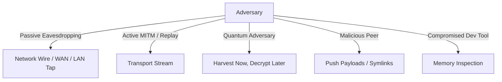

# Security Policy & Threat Model

Slug is designed as a security-critical, post-quantum resilient tool for peer-to-peer workspace sharing and synchronization. We take vulnerability reports seriously and appreciate the efforts of the security research community.

---

## 1. Reporting a Vulnerability

If you discover a security vulnerability, security flaw, or cryptographic weakness in Slug, **please do not disclose it publicly or open a public GitHub issue**.

### Reporting Channels:
1. **GitHub Security Advisory (Preferred)**:
   Navigate to the repository's **Security** tab and click **"Report a vulnerability"** to open a confidential private advisory draft.
2. **Direct Email**:
   Send an email directly to:
   ```text
   admin@ghedahaui.online
   ```
   Subject format: `[SECURITY] Vulnerability Report: <Brief Description>`

### Information to Include:
- A detailed description of the vulnerability and attack vector.
- Proof of Concept (PoC) code or exact steps to reproduce.
- Impact assessment: affected components (KEM, AEAD, AI Scanner, Path Traversal, RBAC, etc.).
- Target environment details (OS, architecture, compiler, commit hash/version).

### Response SLA:
- **Initial Response**: Within 24 hours acknowledging receipt.
- **Triage & Assessment**: Within 72 hours with preliminary severity classification.
- **Remediation & Patching**: Critical vulnerabilities will be patched within 7 business days, followed by a coordinated security advisory publication.

---

## 2. Supported Versions

| Version | Supported | Security Updates |
| :--- | :--- | :--- |
| `1.0.x-rc` | Yes | Active security patches |
| `< 1.0.0` | No | End of life |

---

## 3. Threat Model

Slug operates in peer-to-peer developer networks, untrusted LANs, and point-to-point WAN environments. The threat model defines our security boundaries, adversary capabilities, and defense guarantees.

### 3.1 Assets Under Protection
1. **Workspace Files & Intellectual Property**: Source code, build artifacts, diagrams, and project assets.
2. **Secrets & Credentials**: Private keys (`.pem`, `.key`), cloud tokens (AWS, Stripe, GitHub PAT), database credentials, and `.env` files.
3. **Session Credentials**: One-Time TOTP authentication tokens and ephemeral RBAC credentials.
4. **Endpoint Host Integrity**: Ensuring push/pull operations cannot write outside the designated workspace root directory (anti-directory traversal).

### 3.2 Adversary Models



#### A. Passive Network Eavesdropper (Wiretapper)
- **Capability**: Observes all traffic between host and client over untrusted WiFi, corporate LAN, or public internet.
- **Defense**: All transport data is end-to-end encrypted with XChaCha20-Poly1305. The key exchange utilizes NIST FIPS 203 (`ML-KEM-768`), rendering traffic immune to both classical and quantum "Harvest Now, Decrypt Later" eavesdropping.

#### B. Active Man-In-The-Middle (MITM) & Replay Adversary
- **Capability**: Injects, alters, drops, or re-sends packets. Attempts to capture old authentication tokens to gain unauthorized access.
- **Defense**:
  - Mutual key exchange bound with digital signatures (`ML-DSA-65` FIPS 204 or `Ed25519`).
  - RFC 6238-compliant TOTP codes are **single-use only (Burn-on-use)**: Once validated, the token is recorded in memory and permanently rejected for all subsequent attempts.
  - Constant-time string and memory comparisons (`CRYPTO_memcmp`) to defeat timing side-channel attacks.
  - 64-bit monotonically increasing sequence numbers with a 64-packet anti-replay sliding window.

#### C. Malicious Peer or Compromised Client
- **Capability**: An authenticated peer with `rw` push access attempts to escape the root directory using path traversal (`../../etc/passwd` or symlink redirection).
- **Defense**:
  - `PathUtils::resolve_safe_path`: Rejects any relative path containing `..` tokens.
  - Strict canonical resolution (`weakly_canonical`) verifying the resolved destination is strictly prefixed by the workspace root separator.
  - Symlink target boundary validation: Rejects symlinks pointing outside the workspace boundary.

#### D. Accidental Operator Secret Leakage
- **Capability**: A developer runs `slug add` on a directory containing accidentally committed `.env`, AWS access keys, or SSH private keys.
- **Defense**:
  - **Stateful AI Secret Guard**: Evaluates Shannon entropy (> 4.5 bits/char) and heuristic regex signatures before any file is registered into the transfer manifest.
  - Flagged files are automatically excluded from the remote manifest and cannot be fetched by clients.
  - Explicit user override (`slug audit allow --reason ...`) required to whitelist any false positives.

#### E. Local Disk Extraction & Cold Storage
- **Capability**: An attacker or local process reads the developer's filesystem to harvest plaintext credentials.
- **Defense**:
  - **EnvShield (`slug env`)**: Replaces `.env` on disk with post-quantum encrypted `.env.pqc`.
  - Secrets are decrypted exclusively into process RAM during child process execution and wiped with `OPENSSL_cleanse` immediately after injection.

---

## 4. Out-of-Scope Threat Scenarios

The following scenarios are considered outside the threat model:
- Compromise of the host operating system kernel, root/administrator accounts, or hardware (e.g. rootkits, hypervisor breakouts).
- Physical access to unencrypted system RAM on the host machine while the process is actively executing.
- Social engineering of an authorized operator to voluntarily reveal their active TOTP code.
- Denial of Service (DoS) resulting from saturated upstream network bandwidth.
