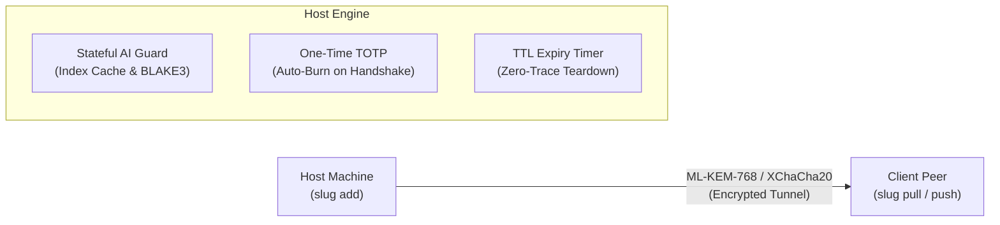
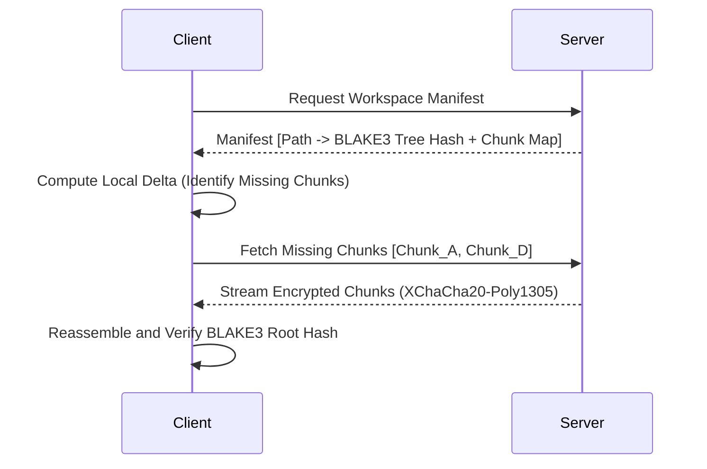
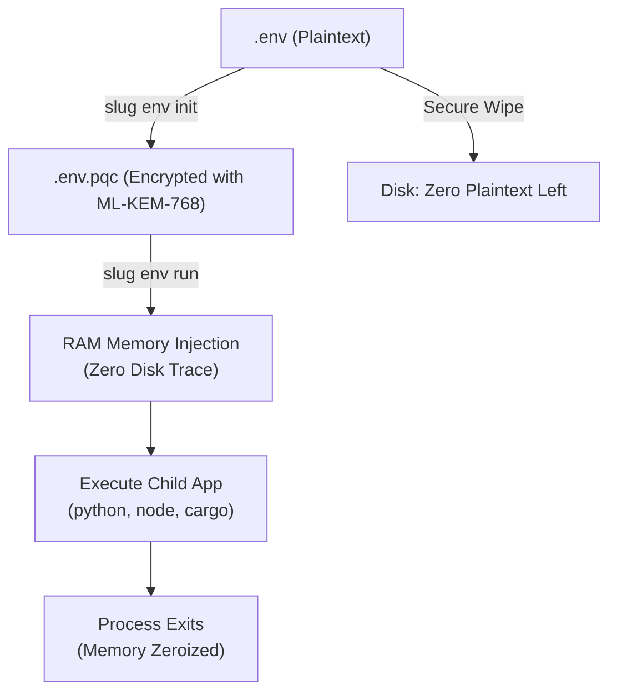

# Slug - Comprehensive User & Security Engineer Tutorial

> **Slug: Secure, Ephemeral, Git-like Workspace Sharing and Synchronization**
> License: Apache-2.0 | Architecture: Zero-Runtime-Dependency Portable C++20

---

## Table of Contents

1. [Introduction](#1-introduction)
2. [Installation on Linux (Any Distribution)](#2-installation-on-linux-any-distribution)
3. [Installation on Microsoft Windows](#3-installation-on-microsoft-windows)
4. [Cryptographic Architecture & Suites](#4-cryptographic-architecture--suites)
5. [Quickstart: Ephemeral P2P Workspace Sharing](#5-quickstart-ephemeral-p2p-workspace-sharing)
6. [Identity, TOTP 2FA, and Ephemeral RBAC](#6-identity-totp-2fa-and-ephemeral-rbac)
7. [Git-like Differential Sync & 64 KiB Chunking](#7-git-like-differential-sync--64-kib-chunking)
8. [Stateful AI Secret Guard & Rules Engine](#8-stateful-ai-secret-guard--rules-engine)
9. [EnvShield: RAM-only Secret Execution](#9-envshield-ram-only-secret-execution)
10. [Performance & Benchmark Suite](#10-performance--benchmark-suite)
11. [Red Team & Field Operations Workflows](#11-red-team--field-operations-workflows)
12. [CLI Command Reference (Cheatsheet)](#12-cli-command-reference-cheatsheet)

---

## 1. Introduction

Slug is a security-first, developer-centric tool for sharing and synchronizing workspaces across machines without relying on central cloud storage, Git repositories, or long-lived credentials.

### Why Slug instead of Git, Rsync, or SSH?

| Dimension | Git / GitHub | Rsync / SCP | Slug |
| :--- | :--- | :--- | :--- |
| **History Model** | Permanent commit log | In-place file mirror | Ephemeral session-bound sync |
| **Transport Crypto** | Standard TLS | SSH / OpenSSL | Hybrid & Post-Quantum (ML-KEM-768/ML-DSA-65) |
| **Access Control** | SSH Keys / Personal Tokens | OS user accounts | 8-digit One-Time TOTP + TTL auto-expiry |
| **Secret Shield** | Scanners on remote push (post-facto) | None (copies secrets verbatim) | Stateful AI Guard + Rules engine (blocked pre-transit) |
| **Secrets in RAM** | Plaintext files on disk | Plaintext files on disk | EnvShield (`.env.pqc` RAM-only decryption) |
| **Portability** | Requires Git installation | Requires rsync/ssh binaries | Single static binary (0 external dependencies) |



---

## 2. Installation on Linux (Any Distribution)

Slug is distributed as a **fully static ELF binary** (`slug-static`). It has zero external shared library dependencies (`glibc` or `musl` independent at runtime), making it compatible out of the box with:
- Ubuntu, Debian, Kali Linux, Linux Mint, Pop!_OS
- Fedora, CentOS, Red Hat Enterprise Linux (RHEL), Rocky Linux, AlmaLinux
- Arch Linux, Manjaro, EndeavourOS
- Alpine Linux (musl libc)
- Void Linux, openSUSE, NixOS

### Method A: One-Line Universal Installer (Recommended)

Run the automated installer script:
```bash
curl -fsSL https://raw.githubusercontent.com/slugproject/slug/main/scripts/install.sh | bash
```

If you already cloned the repository or have the binary locally:
```bash
./scripts/install.sh
```

The script automatically:
1. Detects your architecture (`x86_64` or `aarch64`).
2. Installs the static executable to `/usr/local/bin/slug` (or `~/.local/bin/slug` if non-root).
3. Configures auto-completion in `/etc/bash_completion.d/slug`.
4. Verifies the installation with `slug version`.

### Method B: Debian / Ubuntu Package (.deb)

For Debian, Ubuntu, Kali, and derivatives:
```bash
# Build the .deb package locally:
./scripts/package_deb.sh

# Install via dpkg:
sudo dpkg -i dist/slug_1.0.0-rc1_amd64.deb

# Or via apt:
sudo apt install ./dist/slug_1.0.0-rc1_amd64.deb
```

### Method C: Standalone Static Binary (Zero Installation)

Download the universal tarball, extract, and place `slug` in your `$PATH`:
```bash
tar -xzf dist/slug-1.0.0-rc1-linux-x86_64.tar.gz
cd slug-1.0.0-rc1-linux-x86_64/
sudo mv slug /usr/local/bin/
sudo chmod +x /usr/local/bin/slug
```

---

## 3. Installation on Microsoft Windows

Slug natively supports Windows 10, Windows 11, and Windows Server 2016+ (x64 architecture).

### Method A: Automated PowerShell Installer

Launch an elevated or standard PowerShell terminal and execute:
```powershell
# From local repository:
powershell -ExecutionPolicy Bypass -File scripts\install.ps1

# Or via remote one-liner:
irm https://raw.githubusercontent.com/slugproject/slug/main/scripts/install.ps1 | iex
```

The installer:
1. Installs `slug.exe` to `%LOCALAPPDATA%\slug\bin\slug.exe`.
2. Permanently registers the directory to your user `PATH`.
3. Verifies `slug version` immediately.

### Method B: Native Compilation using Visual Studio 2022 (MSVC)

Prerequisites:
- Visual Studio 2022 with C++ Desktop Development (MSVC C++20).
- CMake 3.20+ (`winget install Kitware.CMake`).
- OpenSSL (available via vcpkg or Chocolatey: `choco install openssl.light`).

Execute the automated Windows build script:
```cmd
scripts\build_windows.bat
```
Or build manually:
```cmd
cmake -B build -S . -DCMAKE_BUILD_TYPE=Release
cmake --build build --config Release -j
```
The compiled standalone executable will be located at `bin\slug.exe`.

---

## 4. Cryptographic Architecture & Suites

Slug eliminates algorithm lock-in by providing three distinct cryptographic suites, negotiated dynamically during the initial handshake:

| Suite ID | Cryptographic Suite Name | KEM (Key Exchange) | Signature Algorithm | Symmetric Cipher | Hash Function | Quantum Safe? |
| :--- | :--- | :--- | :--- | :--- | :--- | :--- |
| **Suite 1** | Classical | X25519 (ECDH) | Ed25519 | XChaCha20-Poly1305 | SHA-256 | No |
| **Suite 2** | Modern | X25519 (ECDH) | Ed25519 | XChaCha20-Poly1305 | BLAKE3 | No |
| **Suite 3** | **PurePQC (Default)** | **ML-KEM-768** (FIPS 203) | **ML-DSA-65** (FIPS 204) | **XChaCha20-Poly1305** | **BLAKE3** | **Yes** |

### Why Pure Post-Quantum (Suite 3)?
In Suite 3, Slug uses NIST FIPS 203 (`ML-KEM-768`, formerly Kyber) for lattice-based encapsulation and NIST FIPS 204 (`ML-DSA-65`, formerly Dilithium) for digital signatures. This protects your data against "Harvest Now, Decrypt Later" quantum adversary campaigns.

---

## 5. Quickstart: Ephemeral P2P Workspace Sharing

### Step 1: Host a Workspace on Machine A
To share a folder `./my_project` on port `9443` using Suite 3 (PurePQC) and a session TTL of 4 hours:

```bash
slug add ./my_project -p 9443 -s 3 --ttl 4h -ai --daemon
```

Terminal output:
```text
+----------------------------------------------------------------------------+
| SLUG SECURE WORKSPACE HOSTED SUCCESSFULLY                                  |
+----------------------------------------------------------------------------+
  Port:            9443
  Crypto Suite:    Suite 3: PurePQC (BLAKE3/ML-DSA-65/ML-KEM-768/XChaCha)
  AI Secret Guard: ENABLED (Stateful BLAKE3 Audit)
  Session TTL:     4h
  One-Time TOTP:   49182305 (Rotates in 30s)
  Directory Drop:  http://127.0.0.1:9443/drop
  Admin Dashboard: http://127.0.0.1:9443/admin
+----------------------------------------------------------------------------+
```

### Step 2: Test Connection from Machine B
On the recipient machine, verify connectivity and complete the cryptographic handshake:
```bash
slug connect -i 192.168.1.50 -p 9443 -o 49182305
```

Terminal output:
```text
[*] Establishing secure connection to 192.168.1.50:9443...
[*] Initiating Post-Quantum Handshake (ML-KEM-768 / ML-DSA-65)...
[+] Cryptographic handshake verified with host.
[+] Authenticated via TOTP. Session granted (TTL: 4h).
```

### Step 3: Pull Files from Machine A to Machine B
```bash
slug pull ./downloaded_project -i 192.168.1.50 -p 9443 -o 49182305
```
Slug downloads the workspace manifest, performs content verification with BLAKE3, and transfers all authorized files.

### Step 4: Push an Update back to Machine A
```bash
slug push ./downloaded_project src/module.cpp -i 192.168.1.50 -p 9443 -u alice -W secret_pass
```

### Step 5: Web GUI & Air-Drop Interface
Anyone on the local network authorized with the TOTP token can navigate to:
- `http://192.168.1.50:9443/drop` — Direct browser download of shared files.
- `http://192.168.1.50:9443/admin` — Interactive admin dashboard with live benchmark metrics.

---

## 6. Identity, TOTP 2FA, and Ephemeral RBAC

Slug supports two authentication layers:

### 1. Zero-Config One-Time TOTP (Default)
When a workspace starts, Slug generates an RFC 6238-compliant 8-digit TOTP code that rotates every 30 seconds.
- Single-use policy: Once a peer authenticates using the active TOTP code, the code is immediately burned and cannot be replayed.
- Replay prevention: Timestamp verification with strict drift tolerance.

### 2. Scoped Role-Based Access Control (RBAC)
For multi-user workspaces, define access permissions in `.slug/users.conf`:

```conf
# User configuration format:
# <username>:<password_hash>:<role>:<allowed_subpath>:<ttl_seconds>
alice:$2b$12$e8...:rw:src/:14400
bob:$2b$12$k2...:r:docs/:3600
auditor:$2b$12$x9...:audit:/:1800
```

- `r` (Read Only): Can pull manifests and download files. Cannot push.
- `rw` (Read/Write): Can pull and push modifications within `allowed_subpath`.
- `audit` (Auditor): Can inspect audit logs and flag statuses without downloading sensitive data.

---

## 7. Git-like Differential Sync & 64 KiB Chunking

Slug uses Content-Addressable Storage (CAS) with 64 KiB fixed chunk boundaries.



### Checking Changes Before Pulling
Inspect differences between remote and local workspaces:
```bash
# Compare status
slug status

# Inspect file-by-file delta diff
slug diff ./local_copy -i 192.168.1.50 -p 9443 -o <TOTP>
```

---

## 8. Stateful AI Secret Guard & Rules Engine

When `-ai` is enabled, Slug inspects every file before transit to prevent secret leakage.

### Detection Heuristics:
1. **Shannon Entropy Analysis**: Scans lines exceeding 4.5 bits/char entropy.
2. **Regex Patterns**: Detects AWS keys, Stripe keys, GitHub tokens, Slack Webhooks, RSA/EC private keys.
3. **Keyword Proximity**: Context analysis around `password`, `bearer`, `token`, `auth`.

### Stateful Cache (`.slug/index.db`)
Slug binds scan results to each file's BLAKE3 content hash. Unchanged files bypass repeated rescanning, reducing overhead to **0.017 μs** per file.

### Security Rules Configuration (`.slug/rules.conf`)
You can define declarative blocking or allowlisting rules:

```bash
# Block all files with a .pem extension:
slug rule block --ext pem

# Block any file containing private keys:
slug rule block --contains "BEGIN PRIVATE KEY"

# Allow a specific sample file:
slug rule allow --path ./.env.example

# List current active rules:
slug rule list
```

### Remediation & False Positives
If a legitimate test fixture or documentation mock token is flagged:
```bash
# View all flagged files:
slug audit list

# Whitelist a false positive:
slug audit allow tests/mock_token.ts --reason "Safe mock key for testing"

# Rescan files after secret removal:
slug audit recheck tests/mock_token.ts
```

---

## 9. EnvShield: RAM-only Secret Execution

`slug env` provides envelope encryption for developer `.env` files.



### Usage Steps:

1. **Encrypt `.env` into `.env.pqc`**:
   ```bash
   slug env init -s 3
   ```
   The plaintext `.env` is securely wiped from disk and replaced by `.env.pqc` encrypted via Suite 3.

2. **Execute your application in RAM-only mode**:
   ```bash
   slug env run -- python3 server.py
   # or
   slug env run -- npm start
   # or
   slug env run -- ./my_backend
   ```
   Slug decrypts secrets directly into process memory, launches the subprocess with environment variables populated, and immediately zeroes the memory. Plaintext keys never touch disk.

---

## 10. Performance & Benchmark Suite

Slug includes an internal measurement suite to verify cryptographic speeds, hash engine throughput, AI scan latency, and delta chunking rate.

### Run from Terminal:
```bash
# Standard complete benchmark:
slug bench

# Fast benchmark (reduced iterations):
slug bench --quick

# Machine-readable JSON output (for CI/CD pipelines):
slug bench --json --quick
```

Sample benchmark output:
```text
================================================================================
                 SLUG PERFORMANCE & SECURITY BENCHMARK REPORT                   
================================================================================

[1] CRYPTOGRAPHIC SUITE PERFORMANCE COMPARISON:
SUITE                                 KEM KEYGEN    KEM ENCAP     KEM DECAP     KEM OPS/SEC     
------------------------------------------------------------------------------------------------
Suite 1: Classical (Ed25519/X25519)   104 us        67 us         65 us         4198 ops/s      
Suite 2: Modern (BLAKE3/X25519)       28 us         54 us         53 us         7324 ops/s      
Suite 3: PurePQC (ML-KEM/ML-DSA)      38 us         36 us         96 us         5856 ops/s      

SUITE                                 SIG KEYGEN    SIG SIGN      SIG VERIFY    SIG OPS/SEC     
------------------------------------------------------------------------------------------------
Suite 1: Classical (Ed25519/X25519)   33 us         64 us         82 us         5501 ops/s      
Suite 2: Modern (BLAKE3/X25519)       30 us         60 us         84 us         5698 ops/s      
Suite 3: PurePQC (ML-KEM/ML-DSA)      132 us        787 us        133 us        948 ops/s       

SUITE                                 XCHACHA20 ENCRYPT       XCHACHA20 DECRYPT       
--------------------------------------------------------------------------------------
Suite 1: Classical (Ed25519/X25519)   419.2 MB/s              486.3 MB/s              
Suite 2: Modern (BLAKE3/X25519)       466.3 MB/s              505.9 MB/s              
Suite 3: PurePQC (ML-KEM/ML-DSA)      471.2 MB/s              503.3 MB/s              

[2] HASH ENGINE SHOOTOUT:
ALGORITHM                         THROUGHPUT (MB/s)     LATENCY (10MB)      
----------------------------------------------------------------------------
BLAKE3 (Tree-hashing / 256-bit)   1051.8 MB/s           4.75 ms             
SHA-256 (OpenSSL EVP)             2312.9 MB/s           2.16 ms             

[3] STATEFUL AI SECRET GUARD & CACHE:
  - Heuristic Scan Throughput: 6.4 MB/s (215698 lines/sec)
  - Stateful Index Cache Hit:  0.015 us / file lookup (0ms overhead on unchanged files)

[4] DELTA SYNC PIPELINE (64 KiB Content-Addressable Chunker):
  - Chunking Throughput:       1047.9 MB/s
  - Chunk Rate:                16767 chunks/sec
================================================================================
```

### Run from Web GUI:
1. Open `http://<server-ip>:<port>/admin` in your web browser.
2. Locate the **Performance & Cryptographic Benchmark** card.
3. Click the **"Run Real-Time Benchmark"** button to execute measurements live on the server.

---

## 11. Red Team & Field Operations Workflows

For penetration testers and security engineers transferring engagement data across untrusted networks:

### Scenario: Securely Transferring Toolchains, Payloads, or Reports
1. **On the Operator Machine (Linux)**:
   ```bash
   slug add ./lab_artifacts -p 18443 -s 3 --ttl 30m -ai --daemon
   ```
2. **On the Target / Pivot Machine (Windows)**:
   ```powershell
   slug.exe pull C:\staging -i 10.10.14.2 -p 18443 -o <TOTP>
   ```
3. **Security Benefits in the Field**:
   - Zero artifact persistence on central servers.
   - 30-minute session TTL terminates the listener automatically.
   - AI Guard guarantees that sensitive operator keys (e.g., `id_rsa`, AWS tokens) cannot be accidentally synchronized.
   - PQC cipher tunnel protects against passive wire captures and upstream network eavesdropping.

---

## 12. CLI Command Reference (Cheatsheet)

```text
WORKSPACE MANAGEMENT:
  slug add <path> [-p <port>] [-s <1|2|3>] [--ttl <duration>] [-ai] [--daemon]
  slug list
  slug stop -p <port>
  slug status [--flagged]

TRANSFER & SYNCHRONIZATION:
  slug connect -i <ip> -p <port> -o <totp> [-u <user>] [-W <pass>]
  slug pull <local_dir> -i <ip> -p <port> -o <totp> [-u <user>] [-W <pass>]
  slug push <local_dir> <file> -i <ip> -p <port> [-u <user>] [-W <pass>]
  slug diff <local_dir> -i <ip> -p <port> -o <totp>

SECURITY POLICY & RULES:
  slug rule list
  slug rule block --path <path> | --ext <ext> | --contains <str> | --regex <pattern>
  slug rule allow --path <path>
  slug rule rm <rule_id>

AI GUARD AUDIT:
  slug audit list [-P <port>]
  slug audit allow <path> --reason "..." [-P <port>]
  slug audit recheck <path|--all> [-P <port>]

ENVSHIELD:
  slug env init [-s <1|2|3>]
  slug env run -- <command...>

BENCHMARKING & METRICS:
  slug bench [--quick] [--json]

INFORMATION:
  slug version
  slug help
```
